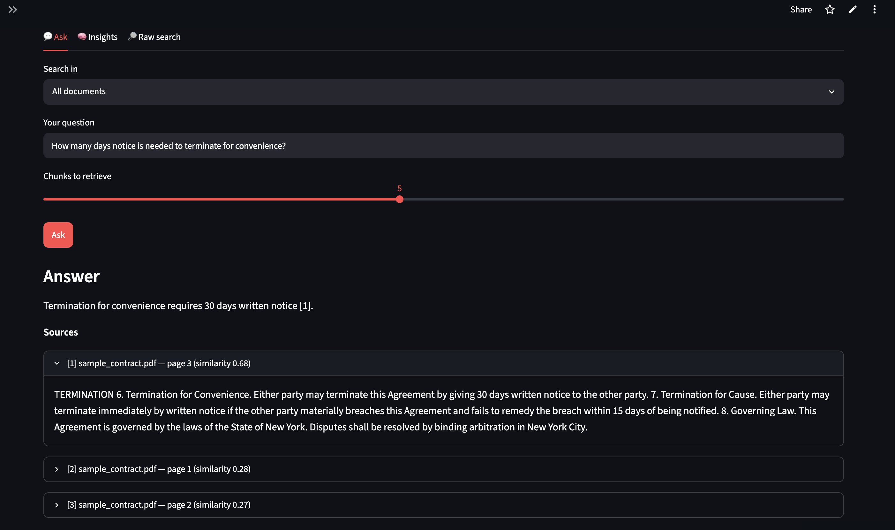
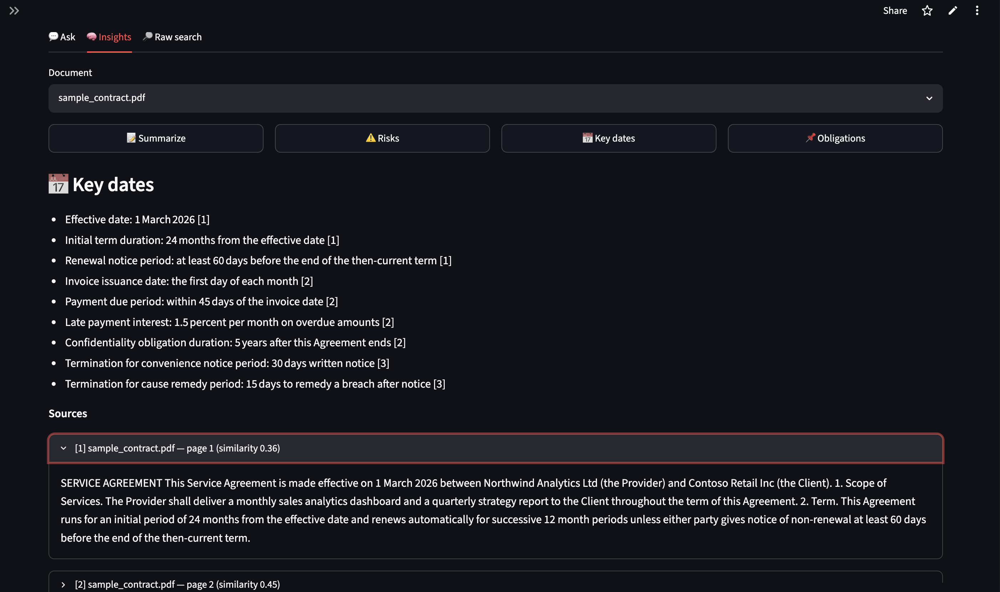
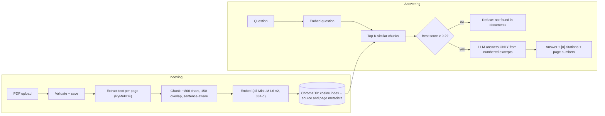

# 📄 Document Intelligence Platform

Upload PDFs (contracts, papers, reports) and **ask questions in plain English**. Every answer
cites the **page** it came from, and says *"I could not find this"* instead of guessing.
One click also gives a summary, risks, key dates or obligations.

**Live demo:** _add your `https://<your-app>.streamlit.app` link here_ · runs on free tiers only.

<!-- Add screenshots to docs/images/ with these names (see the reply that came with this version) -->



## How it works



## Design decisions (and why)

| Decision | Reason |
|---|---|
| Chunks are built **per page** and carry `page` metadata | Makes page-level citations possible |
| **Cosine** distance with a similarity score | Easy to interpret (1.0 = identical meaning); the default L2 distances were not |
| **Relevance threshold** before calling the LLM | If nothing relevant is retrieved, the app refuses instead of letting the model guess |
| Re-uploading a file **replaces only that file's chunks** | Several PDFs coexist; no stale or duplicate chunks |
| Prompts forbid invented clause numbers and narrowing "either party" | Fixes real mistakes seen in testing with a small model |
| **Two LLM providers** behind one function | Local Ollama for privacy/dev, hosted Groq for the free live demo |
| **Two embedding backends**, same model | PyTorch locally if installed, ONNX (no PyTorch) so it fits a ~1 GB free host |
| Whole app runs in **one process** (FastAPI is optional) | One free deployment instead of two services |
| Upload validation: extension, `%PDF-` check, size cap, scan detection | Clear errors instead of crashes |

## Run it locally

Needs Python 3.10+ (developed on 3.12).

```bash
python3 -m venv .venv && source .venv/bin/activate
pip install -r requirements.txt            # light: no PyTorch
# optional: pip install -r requirements-torch.txt   (sentence-transformers instead of ONNX)
# optional: pip install -r requirements-api.txt     (FastAPI server)

brew install ollama && ollama pull llama3.2   # local LLM, ~2 GB (or see "Hosted LLM" below)
streamlit run frontend/app.py                 # one command, opens http://localhost:8501
```

Try it with the bundled contract: `python scripts/make_sample_pdf.py`, then upload
`data/samples/sample_contract.pdf` (already committed, so you can skip this step).

### Optional: run the API server separately

```bash
pip install -r requirements-api.txt
uvicorn backend.main:app --port 8000                              # Swagger UI at /docs
BACKEND_URL=http://127.0.0.1:8000 streamlit run frontend/app.py   # UI talks to the API
```

| Method | Path | Purpose |
|---|---|---|
| POST | `/upload` | Save + index a PDF (replaces an earlier version of the same name) |
| GET | `/documents` · DELETE `/documents/{name}` | List / remove documents |
| GET | `/search?q=…&top_k=5&source=…` | Retrieval only |
| POST | `/ask` | `{"question": "...", "top_k": 5, "source": null}` |
| POST | `/insights` | `{"kind": "risks", "source": "file.pdf"}` (summary, risks, key_dates, obligations) |
| GET | `/db-info` | Counts, distance metric, embedding backend, LLM in use |

## Evaluate it

```bash
python scripts/evaluate.py          # retrieval only: needs no LLM
python scripts/evaluate.py --llm --verbose   # also grades the generated answers and prints them
```

Runs 15 questions on the sample contract (10 answerable with a known page and fact, 5 that
must be refused) and writes `docs/eval_results.md`. Reported: hit rate @K, MRR, correct
refusals. Add your own questions in `data/eval/*.json`.

_Results: run the script and paste the summary lines here._

## Free live demo on Streamlit Community Cloud

1. Push this repo to GitHub (public is simplest).
2. Create a free API key at [console.groq.com](https://console.groq.com) (no credit card).
3. Go to [share.streamlit.io](https://share.streamlit.io) → **Create app** → pick the repo,
   branch `main`, main file `frontend/app.py`. Under **Advanced settings** choose Python 3.12
   and paste your secrets (template in `.streamlit/secrets.toml.example`):

   ```toml
   DEMO_MODE = "true"
   LLM_PROVIDER = "openai"
   LLM_BASE_URL = "https://api.groq.com/openai/v1"
   LLM_MODEL = "llama-3.3-70b-versatile"
   LLM_API_KEY = "your-groq-key"
   ```
4. Deploy. The first start downloads the embedding model (~80 MB), so allow a minute or two.

**Demo mode** pre-loads the sample contract and protects it, lowers the upload limit to 5 MB,
and caps each visit at 30 LLM requests so a visitor can't use up your free quota.
Free-tier apps sleep after a period of no traffic and wake on the next visit. The app's disk
is not permanent, so uploads vanish on restart. The demo is shared, so don't upload private documents.

## Settings (environment variables / secrets)

| Variable | Default | Meaning |
|---|---|---|
| `LLM_PROVIDER` | `ollama` | `ollama` or `openai` (any OpenAI-compatible API) |
| `OLLAMA_MODEL` | `llama3.2` | Local model (`llama3.1:8b` is better if you have 16 GB RAM) |
| `LLM_BASE_URL` / `LLM_MODEL` / `LLM_API_KEY` | Groq defaults | Hosted LLM settings |
| `EMBEDDING_BACKEND` | `auto` | `auto`, `onnx` or `sentence-transformers` |
| `MIN_RELEVANCE` | `0.2` | Similarity below this = refuse to answer |
| `CHUNK_SIZE` / `CHUNK_OVERLAP` | `800` / `150` | Characters; applies to newly indexed documents |
| `MAX_UPLOAD_MB` | `50` (`5` in demo) | Upload limit |
| `DEMO_MODE` / `DEMO_MAX_QUESTIONS` | `false` / `30` | Public-demo behaviour |

## Project layout

```
frontend/app.py              Streamlit UI (Ask / Insights / Raw search)
frontend/client.py           in-process client (default) and HTTP client
backend/config.py            all settings
backend/main.py              optional FastAPI server
backend/evaluation.py        scoring functions used by the evaluation script
backend/services/
  pdf_service.py             PyMuPDF text per page; rejects scans and corrupt files
  chunk_service.py           sentence-aware chunks tagged with their page
  embedding_service.py       ONNX or sentence-transformers, same model
  vector_store.py            ChromaDB: add / replace / delete / search (cosine)
  ingest_service.py          upload pipeline shared by the UI and the API
  llm_service.py             Ollama or OpenAI-compatible client with friendly errors
  rag_service.py             prompts, relevance filter, Q&A and the four insights
scripts/                     make_sample_pdf.py, evaluate.py
tests/                       unit tests (chunking, ingest, LLM errors, RAG logic, evaluation)
```

Run the tests: `python -m unittest discover` (PDF tests are skipped if PyMuPDF is missing).

## Limitations

- Insights use the 8 most relevant chunks, not the whole document: good for contracts and
  short papers, an approximation for long books.
- No OCR: scanned PDFs are rejected with a clear message.
- Small models can still misread legal text. This is a reading aid, **not legal advice**; always check the cited page.
- Changing the embedding model or chunk settings requires re-uploading documents.

## Next steps

OCR (Tesseract), hybrid keyword + vector search, a re-ranker, streaming answers, per-user
document isolation and authentication.
